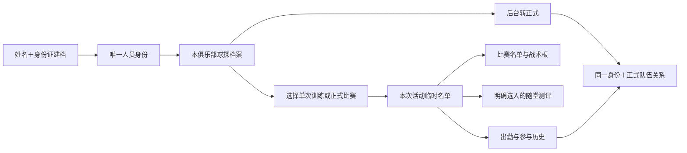

# SC01 球探身份与单次活动临时球员设计

状态：2026-09-22 用户回复“好的”，已采纳所提交的业务通路、数据设计方向与前端布局。此为原始确认记录；2026-10-05 用户委托总控定稿的最新规则见文末，覆盖第8节名单权限、课后补加和临时测评的待定状态。工程实施与验收由 09-23 主任务跟踪。

## 1. 现状与需要补齐的部分

| 层面 | 已有依据 | 结论 |
| --- | --- | --- |
| 需求 | REQ-ORG-003、ACC-03、REQ-SVC-004 | 已有独立球探库、临时参训、转正式保留历史要求，不重建需求体系 |
| 后台设计 | D06 球探人员库 18:27、D07 球探档案与转入 18:32；本轮检查截图 | 已有新建入口、列表与历史骨架；未构成教练端建档选人闭环 |
| 身份 | student_profiles、student_operational_profiles.id_document_hash/external_ref | student_profiles 没有证件唯一约束；已有 hash 字段也未见 UNIQUE；导入有把身份证映射 external_ref 的路径，不能拿它直接当安全唯一身份库 |
| 活动 | event_participants 唯一 (club_id,event_id,student_id) | 可复用活动与人员关联；缺临时来源、移除语义及专门名单操作权限 |
| 比赛 | match_rosters、比赛事件录入接口 | 比赛录入同时检查活动参与与比赛 roster，两者必须一起贯通；roster 现有索引非唯一 |
| 教练 | 当前 team/attendance/match/tactical-board 页面 | 未见球探建档/共享选人页；教练个人雷达权限依赖正式 team_members，需补事件范围访问，不能绕过全部权限 |
| 出勤副作用 | apps/api/src/store.ts:2120 recordEventParticipants | present/late 会调用 recordLessonAdjustment(debit,-1)，接入名单前必须隔离与已确认规则冲突的扣账副作用；这是本地代码发现，不是生产运行结论 |

代码来源：`apps/api/db/migrations/0001_platform_foundation.sql`、`0002_data_capability_foundation.sql`、`0017_match_rosters.sql`；`packages/domain/src/actors.ts`、`calendar.ts`、`match.ts`；`apps/api/src/application/services.ts:394`；`apps/api/src/routes/app-client.routes.ts:775`、`:2808`；`apps/api/src/persistence/data-capability-repositories.ts:1943`。行号为本轮快照。

[Figma D06](https://www.figma.com/design/EyQtDtILGDZDf6neLBL6vs?node-id=18-27) · [Figma D07](https://www.figma.com/design/EyQtDtILGDZDf6neLBL6vs?node-id=18-32)

## 2. 产品模型

四件事分开：这个人是谁、在本俱乐部有哪些资料、是否正式属于队伍、是否参加某次活动。

身份证是识别凭据，不充当页面URL、业务主键、登录凭证或家长绑定凭据。单次参加不创建正式队伍关系，不自动订课、购买、绑定家长。球探档案存在不等于参加；加入名单也不等于实际出场。

## 3. 数据结构（建议新增/扩展，字段名待实现时对齐）

| 对象 | 核心字段与约束 |
| --- | --- |
| PersonIdentity 身份登记 | personId；documentType；规范化证件号的带密钥摘要；加密证件值；脱敏尾号；身份修订版本。唯一(documentType,documentDigest)。不以姓名唯一，不把校验格式称为真人核验 |
| ClubPlayer 俱乐部球员 | 延用本俱乐部 studentId，关联 personId；唯一(clubId,personId)。保持已有出勤/测评/比赛 studentId 外键。student_profiles 的存在不等于正式入队 |
| ScoutProfile 球探资料 | clubId、studentId、来源/创建人/时间、有效状态；唯一(clubId,studentId)。建档只必填姓名、身份证；照片、位置等后补，专业观察沿既有服务记录权限另存 |
| TeamMembership 正式归属 | 复用 team_members；正式入队另行操作，不随临时参加自动创建 |
| EventParticipant 单次名单 | 复用现有唯一键，扩展 rosterSource(team/scout)、active/removed、addedBy/At、removedBy/At、revision；出勤 status 独立，不用 removed 冒充 absent。来源按当时快照记录 |
| MatchRoster 比赛可用名单 | 对 matchId+studentId 去重，关联活动参与者。添加临时人员时只进入可用名单，不自动首发、不预填出场分钟、不自动上球场 |
| 历史与结果 | 沿用 studentId+eventId 及已有业务对象；添加、移除、恢复、身份更正、转正式保留审计记录；不复制成绩和比赛台账 |

唯一性按系统人员身份层设计，跨俱乐部只共享不可直接访问的身份关联，各俱乐部资料、球探意见、联系人、活动历史仍独立授权。普通教练不能借重复建档提示查询另一俱乐部身份或关系。若正式人员已经存在，则同俱乐部复用同一 studentId，绝不能为其再造一份“球探球员”。

证件规范化与校验在服务端统一；新建流程限定用户当前要求的身份证，不扩展护照等流程。新输入按正式规范校验；不要求证件照片。加密和摘要密钥分离，轮换时保留统一身份和唯一性，不因密钥版本产生重复人。日志/监控/URL/埋点不记录明文证件；原始表单不落持久本地缓存。

## 4. 核心业务通路

### 4.1 新建与去重

1. 教练在当前俱乐部或本次事件的选人页点击新建；后台从 D06 新建。
2. 填姓名、身份证。服务端验证角色、俱乐部范围、数据格式；同一事务解析或创建人员身份、当前俱乐部球员与球探资料。
3. 同证件同人已存在：返回当前俱乐部有权使用的档案，提示“已建档，使用已有球员”。本队正式球员直接识别为已在名单，不变成临时身份。
4. 同证件姓名不一致：不覆盖原姓名，不再建人；明确“信息不一致，请核对或联系后台”，由后台有权人员修正身份并留痕。跨俱乐部不回显别处的姓名或资料。
5. 并发靠唯一约束和幂等键收敛，失败整体回滚，不产生孤立半档案。建档成功后可继续“加入本次”，不是强行再填一次。
6. 建档成功但加入失败：明确“档案已保存，尚未加入本次”，重试只重试加入，不重复建档。

### 4.2 选择并加入本次活动

1. 当前事件携带 eventId、clubId，服务端返回教练的名单编辑能力。教练可创建最小档案；本场名单编辑还要有该场授权，不能仅凭教练角色操作任何事件。
2. 选择页查询当前俱乐部获准球探名单；按姓名搜索，可用球员编号、照片、年龄及脱敏尾号区分同名。已加入人员置灰并标“已在本次名单”。支持多选、显示数量。
3. 提交 studentIds+名单版本+幂等键；服务端逐一验证身份、俱乐部与权限，以及事件未取消。全部通过后事务加入，失败返回明确原因，不静默半成功。
4. 同事件不重复；移除后再加入恢复原关系及历史，不新增第二人次。跨场次只改变目标场次，不改系列日程或其他课程。
5. 若是正式比赛，事务同步比赛可用 roster；若比赛实体尚不存在，先走既有赛事初始化或明确返回待完善，不能伪报添加成功后无法选择球员。
6. 成功回当前活动，刷新出勤名单、比赛记录选人、战术板候选和后台名单。即使使用缓存，也需按事件修订版本失效并回读确认。

### 4.3 参加、测评、移除和转正式

- 训练临时球员按本次有效名单使用既有出勤机制与修正规则；正式比赛独立记录参与。自动出勤重试不覆盖手动结果，不生成课包扣账。单次临时参与纳入个人历史，正式成员人数/长期出勤率的分母不直接掺入临时人员，名单显示“正式 N · 临时 M”。
- 2026-10-05 已定：课程结束前加入者纳入本次既有自动处理；结束后补加须选择参加/未参加，名单与人工状态一并保存，不需要审批。正常培训统计原则不变。
- 不自动成为已有测评必测对象；可在有权随堂测评中明确选入，沿用草稿/确认流程。2026-10-05 已定：有本课测评权限的教练明确选入即可，无额外审批；已有任务范围不得随活动名单静默变化，不扩大历史成绩访问。O-06 其他边界仍单独保留。
- 仅有邀约尚无事实时可移出本场候选；已有出勤/测评/比赛记录时不得级联删除。明确影响、留移除历史；若原事实错误，进入各自更正流程，不用移除名单抹掉结果。移除同时使未执行的战术候选失效；保存战术历史不删除事实。
- 取消活动停止新增名单及自动处理，保留此前参与与结果历史；改时间地点继续使用同 eventId。
- 后台转正式沿用相同 personId/studentId，仅新增正式队伍关系和生效时间；历史仍保留“当次临时参加”来源，不能把全部过去课次重算为正式队员出勤。家长绑定按独立的既有身份授权流程进行，姓名身份证相同不自动授予家长查看权。

## 5. 权限与接口契约

教练可建最小档案是本轮用户明确的新边界。详细敏感资料仍不自动开放；教练建档输入身份证不等于可在列表、详情、导出中读取完整身份证。后台身份更正、合并、转正式与教练活动操作分开授权。

建议服务能力如下（路由为设计契约，非已存在接口）：

| 能力 | 请求/返回重点 |
| --- | --- |
| POST /clubs/:clubId/scout-players | name、identityNumber、幂等键；返回 created/existing、studentId、脱敏摘要，不返回原证件 |
| GET /clubs/:clubId/scout-players | 名称/球员编号、分页、可选 eventId；仅获准名单与 alreadyIncluded 标记 |
| GET /clubs/:clubId/scout-players/:studentId | 授权基本资料与可见参与历史；不默认开放跨队/跨俱乐部成绩或球探内部意见 |
| POST /clubs/:clubId/events/:eventId/temporary-participants | studentIds、expectedRevision、幂等键；返回本场名单版本与参与者，不经出勤接口冒充新增名单 |
| POST /clubs/:clubId/events/:eventId/temporary-participants/:studentId/remove | 版本、必要移除说明；返回历史保留与结果更正入口 |
| POST /clubs/:clubId/scout-players/:studentId/enroll | 后台能力；目标队伍、生效时间，返回同一身份的新队伍关系 |

教练小程序继续用现有 app-client 路由封装，后台与教练调用同一领域服务，不能实现两套去重/名单逻辑。身份冲突、名单版本冲突、事件取消、无权限分别给稳定错误码。姓名重复本身不是错误。

临时人员不能靠伪造 team_members 通过权限。为活动详情、出勤、比分、战术候选、指定随堂测评增加严格 event-scoped 能力校验；有权处理本场不代表可查看该球员全部历史。

## 6. 前端布局与页面

| 位置 | 设计 |
| --- | --- |
| C03 训练工作台 | 出勤区标题右侧“＋临时球员”；头像名单中临时球员加轻量“临时”标签，出勤操作与正式队员一致；人数旁区分正式/临时。不得挤占底部“变更本次训练” |
| C24 比赛详情 | 比赛名单区右侧“＋临时球员”；加入后进入本场可用名单，战术板候选同步。不在记分面板重新创建球员 |
| C10 队伍管理 | 提供俱乐部级“球探球员库”辅助入口，与当前队伍正式名单分开；不新增底部 Tab |
| D06/D07 后台 | 复用现有球探库、新建、档案和转正式；补去重结果与身份异常处理。后台训练/比赛名单也使用同一选择能力 |

共享页面使用 SC 设计代号，尚未注册为 Figma 页面编号：

**SC-SELECT 选择临时球员**

- 顶部：返回、标题“添加临时球员”、当前队伍/活动名称和时间。
- 搜索框 → 名单行（照片、姓名、年龄/位置如有、脱敏尾号或球员编号、勾选/已加入）→ 空结果“未找到？新建球员”。
- 右上角“新建”；底部固定“加入本次（N）”。无选择不可提交；搜索切换保留选择；退出回原活动，建档后保留已选其他人。

**SC-CREATE 新建球员**

- 姓名、身份证两个必填字段；说明“用于识别同一球员，避免重复建档”。可选头像不阻塞建档。
- 从活动进入：按钮“保存并选中”，返回选择页；从球探库进入：“保存”，进入档案。按钮不能在尚未加入时提示“已加入”。
- 已存在：展示获准的脱敏摘要，“使用已有球员”；身份不一致：保留当前输入并引导核对。弱网、失败保留本页输入，离开不持久保存证件。

**SC-PROFILE 临时球员档案**

- 基础信息 → 授权范围内训练/比赛参与历史 → 已获准能力结果（存在且允许时）。没有数据用真实空态。
- 若来自当前活动，可“加入本次/已在名单”；从库独立进入不猜测要加入哪场。教练不显示后台的转正式或敏感信息更正操作，除非另有授权。

这些功能布局已获用户采纳，后续按修改计划进入 Figma 改图；与原页面组件、字体、色彩保持一致。后续验证小屏、长姓名、同名人员、键盘、空库、重复身份、无权、活动取消、名单版本冲突和保存失败状态。

## 7. 迁移、兼容与回滚

- 先盘点现有 studentId、证件hash/external_ref 与导入映射；历史无证件者保留原ID并标待补，不填假身份证。证件冲突人工核对，不按姓名/手机号自动合并。正式人员和球探库共用去重入口。
- 新身份关联采取增量迁移，保持旧 studentId 和历史外键；只有核对通过后才建立唯一索引。导入和教练/后台新建必须经过同一身份解析服务，避免绕过唯一规则。
- 如同一自然人历史存在多个记录，使用后台可审计合并流程迁移引用，处理重复参与/比赛记录和权限冲突；不能让“唯一约束”靠删除历史来通过。
- 先修正出勤写入副作用和各端授权过滤，再开放临时参与入口。读取名单成功不是完整可用证明。
- 逐俱乐部启用入口；失败可关入口而保留已有身份/事件关联和历史。迁移前备份验证；不通过删除新增身份行回滚已产生的业务事实。

## 8. 已确认范围与仍待明确的细节

用户已采纳建档去重、单次选人、名单联动、异常处理、转正式历史保留及前端布局。系统级身份唯一与俱乐部资料隔离的具体工程落地、协同教练本场名单编辑权限、课后补加时的参与确认、既有 O-06 临时测评范围仍待明确。本文件相关处理为候选细则，不扩大本次确认范围。没有实施或生产验收结论。

## 2026-10-05 SC01 操作规则定稿（用户委托总控决定）

依据用户“按照简单操作，只留记录，减少审批的标准，你确定一个规则”，本次确定以下规则，不再等待名单权限、课后补加和临时测评三项确认。适用范围为单次活动临时人员，不扩大课程编排、身份更正或正式发布权限。

1. **谁操作**：本场已有执行权限的主教练、助教和协作教练均可添加、移出或更正临时名单；不需要主教练或管理员二次审批。仍校验当前俱乐部和本场权限，撤权后立即拒绝新操作。后台沿用既有业务授权。
2. **正常加入**：从球探库选人直接加入本次；找不到则只填姓名、身份证建档后加入。重复操作不重复建人或计次。建档成功但加入失败时分别反馈，重试只处理未完成步骤。
3. **课后补加**：课程结束前加入沿用既有训练记录规则；结束后补加只选择“参加／未参加”，两者不预选，不要求填写申请或等待审批。确认与名单加入同事务保存，人工状态不被自动任务覆盖。比赛补加只确认是否参加，不自动填首发、时长或比赛事件。
4. **测评**：临时球员在本课测评选人中可直接勾选，不额外审批；未选中不成为必测对象，不算缺测或零分。加入活动不自动改动已创建任务的固定名单；有测评权限的教练可在任务的对象编辑动作中明确加入并留历史。成绩仍使用现有录入、确认/修订流程，确认是结果发布动作，不新增人员审批。
5. **移出与更正**：误加且尚无业务事实时可直接移出，保留原关系和变化记录，重加复用原关系；已有训练、成绩或比赛事实时保留历史，直接进入对应更正，不用删除名单抹掉结果。备注选填，必要的变更原因由系统按操作记录，不新增必填说明或审批单。取消的活动不再新增人员。
6. **自动留痕与边界**：记录谁、何时、对哪场活动哪位球员、做了什么及前后状态；备注可选。仅影响本场，不自动正式入队、绑定家长、收费或扣课包，也不开放该球员其他队伍的历史。并发冲突提示刷新，不转为人工审批。

验收：授权协作教练直接生效、撤权拒绝；重复加入只一人次；课后状态与名单原子保存；移出/重加历史连续且不删既有事实；临时测评须明确选入、旧任务范围不隐式漂移；每次有效变更均可追溯，无新增审批待办。以上为定稿合同，实施与联调仍须独立留证。
