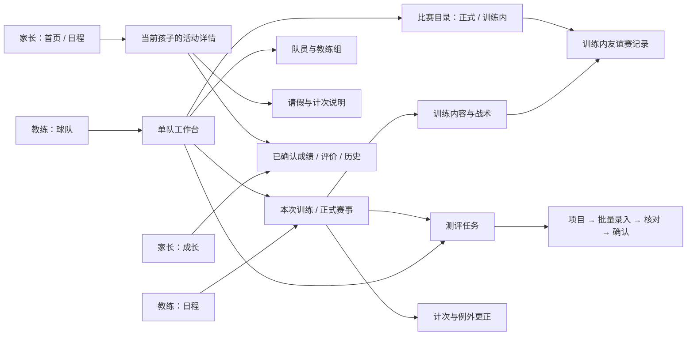
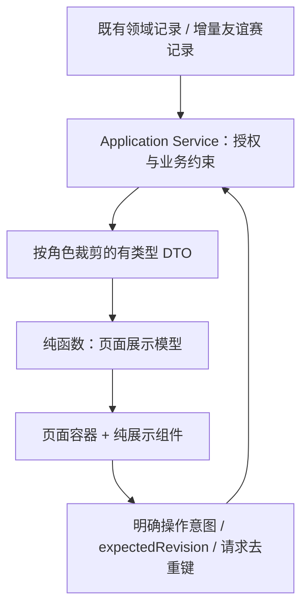

# 全产品体验提升：交互与工程设计

2026-10-22；待审阅设计。要求与验收编号以 [PRD](prd.md) 为准。以下 DTO、组件名和新 API 是拟实施契约，不代表当前代码已具备能力。

## 1. 信息架构：按对象组织，按当前任务给出动作



- 教练底部保留 **日程 / 球队 / 我的**；家长保留 **首页 / 日程 / 成长 / 我的**。不新增全局“录入”Tab，因为录入必须带课程、任务或比赛上下文。
- 一级页显示 role-tabbar；详情页以返回和对象标题定位；编辑页保留返回和单一主动作，不与全局 Tab 争夺底部空间。逐页迁移，历史深链仍可用，不能用全局 CSS 一次移除所有 Tab。
- 日程的“多队范围”与球队页的“当前队伍”是两种含义，保留各自状态。单队上下文沿用已有按环境/俱乐部/用户/教练隔离的存储；由调用者显式传入的 teamId 优先且必须校验。
- `components/role-tabbar/index.ts` 与 `utils/navigation.ts` 统一引用有类型的角色导航定义。先查调用方，处理旧 discover 和 parent/home 差异；不要靠显示文本判断 route。
- 返回优先回原始入口并保留筛选/滚动；没有页面栈时回对应一级页。不使用 reLaunch 清空普通编辑流程；换角色仍按现有会话流程。

## 2. 关键页面与操作流程

### 2.1 教练日程与训练详情（R1、R2）

日程保留当前周/月切换和训练/比赛/其他标记。把“日程范围”压成一行上下文，选中日期、活动和待完成任务占主要空间。当天无活动时仍可看待办；任何卡片显示日期、队伍、地点和状态。待办源自现有任务状态，不能只凭活动已过去就生成“未完成”。

课程首屏布局草图（表示顺序和职责，不是像素稿）：

```text
‹ 日程            射门终结训练              更多
U10精英队 · 10月22日 周四 09:00—10:30
九龙坡足球公园 · 教练姓名             [课程状态]
┌ 本次训练 ───────────────────────────┐
│ 8项内容 · 90分钟                    │
│ 当前适用动作 [查看/调整训练内容]     │
└────────────────────────────────────┘
计次与请假   19人 · 待生成/已计次 N · 例外 N   ›
关联测评     2项待完成任务              继续录入 ›
训练内容     热身 → 射门练习 → 友谊赛…
友谊赛内容   分组对抗              [记录/查看]
人员与临时参训 / 教练协作 / 修改历史           ›
```

主动作随权限与真实状态选择：内容未安排且有权限时“安排训练内容”；有待录任务时突出“继续记录”；课后可“查看训练记录”。课前课后只是推荐顺序，不建立新的禁止编辑时限。变更时间/地点放“更多→变更本次训练”，仍走原服务及权限。

计次流程：摘要→带姓名搜索/全部/例外筛选的紧凑列表→更正→旧值/新值/原因→保存→服务端确认后更新。头像只打开人员摘要，不触发写操作。批量操作不属于这次必做范围，避免把轻易误触扩展到整队。

状态分开描述：活动状态、参与/请假状态、训练计次状态分别呈现；“待生成”不等于缺勤，“已计次”不等于现场签到。列表默认突出请假与人工更正，正常记录可展开查看，历史抽屉按需加载。返回为导航控件，不再成为红色提交按钮。

### 2.2 球队工作台、队员与比赛（R3、R4）

```text
球队       U10精英队 ▾       2026—2027学期
下一次训练：日期 / 地点             查看课程 ›
待办：待录入测评 N · 待核对 N         查看任务 ›
队员 N人         训练安排          测评任务
能力分析         比赛记录
教练组 / 球探工作（按权限与现有开关）
```

工作台展示本队近期活动和任务汇总，已有数据源不可用时局部重试，不阻止其余入口。名单使用姓名搜索与紧凑行：姓名、必要教学信息、个人成长入口；不暴露完整联系人/保险等敏感档案。队员的临时参与标记与正式队籍分开。

比赛目录为 **全部 / 正式赛事 / 训练内友谊赛**，显示类型、日期、对阵、比分状态和原所属训练。聚合结果使用带类型的键，不把训练强制改成比赛。尚未完成新链路时只显示已支持类型与准确说明，不造“暂无比赛”的全量结论。旧正式赛事链接和编辑流程保持有效。

### 2.3 测评任务、项目与批量录入（R5）

维持项目优先的真实流程：球队或课程→任务→项目→按学员录入→保存→核对→确认家长可见。任务默认待处理并显示数量，全部/已完成仍可切；仅保留一个“新建任务”入口。

项目页分别标注“有任意草稿的项目数”“本项目已填人数”“已确认人数”，不共用含糊的“已录入”。保留多项目选择，但核对入口不得遮住继续录入。搜索与分类一起工作；切分类不清空已选项目。

```text
‹ 测评任务     1分钟颠球次数      2/6 项目
U10精英队 · 19人 · 单位：次
所属课程 [选择有效课程]  当前项目已填 7/19
搜索姓名                     全部 / 未填 / 有问题
───────────────────────────────────
丁宁                         草稿已保存
成绩 [       24       ] 次       下一位 →
10月22日训练课                    更改课程
───────────────────────────────────
方圆                         未录入
成绩 [                ] 次
10月22日训练课
───────────────────────────────────
本页有 2 人未保存               [保存并继续]
[核对已保存结果] 为次级入口，不能绕过保存校验
```

- 姓名/状态一行，输入/单位一行，课程为可读摘要，不将六个控件挤在一行。输入键盘与数据类型匹配；单位固定可见，不能仅靠 placeholder。0 是有效值时保留，空值通过显式空状态表示。
- 多课任务可按现有规则逐条/按项目选择有效课程；页面只提交允许的 courseIds，不因进入某课就把全部历史成绩重新归属该课。
- 局部编辑状态：`clean → dirty → saving → saved`；失败保留输入；409 进入冲突说明并显示当前服务器版本。重新载入须提示哪些未保存值会丢失，不能静默覆盖。
- 已确认后更正才要求明确修订原因；新建草稿不展示误导性“更正原因”。权限与后端必填规则若更严格，按现有契约提示，不前端偷偷绕过。
- 下一项目须先成功保存；未填学员不补零；离开脏表单提供“继续编辑/放弃未保存内容”，不自动提交或发布。页面可保持内存草稿，不默认将未成年人敏感结果长期写入本地存储。
- 核对页按现有确认范围展示可发布/缺项/已确认/待修订的人数与数据来源，再调用现有确认服务。不新增另一套发布状态机。
- 课堂表现记录、教练评价仍各有入口和数据类型，文案明确用途，与标准化测评不相互顶替。

### 2.4 家长首页、活动、成长与我的（R1、R6）

```text
首页：孩子切换 → 下一次活动（完整日期/队伍/地点/查看）
      → 近期成长摘要 → 原有4个可配置快捷位 → 俱乐部内容
活动：日期/地点/教练 → 当前孩子与请假入口 → 本课内容
      → 计次说明 → 已完成且获准可见的友谊赛/正式赛事记录
成长：孩子 → 最近更新/数据来源 → 本期变化和教练评价
      → 已确认测评 → 雷达/趋势 → 训练与比赛历史
我的：孩子与绑定 → 账号/角色 → 服务/教练/场地 → 帮助/设置
```

保留品牌、球员卡、里程碑、新闻 Banner 和四个快捷位的能力；可以压缩卡片和调整顺序，不硬删已有配置。成长摘要只来自明确的数据和教练评价；不足以比较时解释“暂无可比较的已确认记录”。雷达仍保留，旁有文本值、日期、标准版本和个人历史对比，不通过竞技排名吸引注意。

多孩子：全部日程可以展示多个孩子；操作请假、查看个体成绩、打开个人事件时必须有明确 studentId。同场有两个孩子时提供选择或两条摘要，不使用 participants[0] 隐式决定操作对象。

### 2.5 后台（R7）

保留工作台、数据管理、评测与模型、BI 分析、专业服务、管理设置。工作台已经存在；调整已有“近期活动、待办、导入问题、服务处理”的顺序和可钻取性，不再建第二个工作台。

数据管理内部为五组，完整映射见 [route-map](research/route-map.md)：

1. 人员与队伍：学员、队伍、队员、教练、任职、家长/绑定/联系人、运营资料、球探。
2. 课程与记录：活动、场地、学期、参训、训练计次、保险、课包台账。
3. 教学资源：练习库、训练计划、能力指标、采集项目、评价用语。
4. 内容与展示：公告、品牌、Banner、分享模板、可选功能。
5. 导入与账号：导入批次、账号与角色。

列表保留权限对应的查询/导出/编辑能力；按资源提供恰当筛选和默认列。打开对象详情沿用现有 Drawer 的详情/历史结构，相关记录使用 ID 跳转并保留查询上下文。人员、课程和成绩使用各自的专业分组，避免把所有 schema 字段平铺成一个表单；继续复用 Management 基础设施。

## 3. 视觉与组件契约（R8）

品牌保留当前红色 `#a80f1b`，页面背景 `#f6f7f9`，卡片白，主文字 `#202124`，次文字 `#667085`。红色用于主动作和品牌强调，错误另用语义 token；不能把每个容器都渲染为红色。用标题、对齐、间距与细分隔线组织密集信息，减少重复大卡片。

沿用现有正文 16px、辅助 14px、区块标题 18px、大标题 20px；主控件至少 44px、主要按钮 48px。间距从现有 token 选 4/8/12/16/24 等层级，不在页面散写新值。圆角从既有组件 token 选取；真正缺少的语义 token 在统一文件补充。微信顶部按 statusbar/menuButton 几何计算，底部兼容 safe area；不能把截图中的固定坐标写死。

| 现有组件/模块 | 本次职责 | 不承担的职责 |
| --- | --- | --- |
| app-header / role-tabbar / navigation | 角色导航、标题、返回、safe area | 业务权限判定、数据请求 |
| schedule-calendar / date-picker | 日期选择、活动标记、周月切换 | 计次计算、训练与友谊赛分类改写 |
| activity-card / status-chip | 有类型的活动摘要和明确状态文本 | 从文案解析 ID、自动执行写操作 |
| student-switcher | 当前孩子选择，显示范围 | 决定监护权限 |
| status-view | loading/empty/error/forbidden 与重试入口 | 把失败伪装成空数据 |
| submit-bar | 保存/继续、loading/disabled、未保存提示 | 自动发布、隐式触发财务操作 |
| radar-canvas / radar-comparison | 已确认数据的图表与比较 | 缺值补零、重新计算标准分 |
| 新 context-bar（只在多个页面确认复用后提取） | 单队/多队/孩子/任务上下文，模式明确 | 全局可变业务状态或所有筛选逻辑 |
| 新 metric-entry-row | 姓名、输入、单位、状态、课程摘要，发出编辑意图 | API、得分转换、跨行保存事务 |
| 新 match-summary（同样以实际重复为提取依据） | 正式/训练内的摘要展示及来源链接 | 合并两类领域模型 |

组件 props 为稳定 ID、值和状态，events 以 intent 命名；页面容器持有加载/选择/保存，服务负责授权与领域规则。只有确实在多页重复且语义相同才抽取组件，单页结构可留在页面中。后台复用 AntD/ProComponents，自有语义 token 与小程序一致，不共享 WXML/React 组件源码。

所有界面状态有文字；触控标签可读；动态图形有文本替代；关闭不必要动画并尊重平台能力。正式视觉验收检查 375×812、窄屏、大字、微信胶囊/底部遮挡和后台桌面视口，不能仅凭本次 628×1362 截图宣布通过。

## 4. 数据分层与活动详情投影（R1）



拟扩展当前 App-client 事件详情的可选有类型字段，保留已有 envelope 和旧字段一个兼容期：

```ts
// 设计契约示意；实体 ID 与时间格式沿用项目既有类型。
type EventDetailProjection = {
  eventId: string;
  type: 'training' | 'match' | 'other';
  startsAt: string;
  endsAt: string;
  team: { id: string; name: string } | null;
  venue: { id: string; name: string; address?: string } | null;
  coaches: Array<{ id: string; name: string; roleLabel?: string }>;
  training: null | {
    contentState: 'available' | 'not_arranged' | 'unavailable';
    blocks: Array<{ id: string; title: string; plannedMinutes: number }>;
  };
  children: Array<{
    studentId: string;
    name: string;
    participation: ExistingParticipationView;
    trainingRecord: ExistingTrainingRecordView | null;
  }>;
  capabilities: { canRequestLeave: boolean; canEditTraining: boolean };
};
```

`Existing...` 是已有模型的引用占位，不在实现中声明无约束 any。错误响应负责 unavailable 的具体原因；权限敏感内容不得通过“空数组+前端猜测”泄露存在性。coaches/venue 只包含活动展示所需字段，家长 child 范围由服务端 guardian 校验。

先把授权、关联加载和投影从过长路由处理中抽成现有 application 层的聚焦函数；不重写整份路由。家长和教练读取相同事实来源、按角色裁剪，不一定返回完全相同 DTO。`utils/api.ts` 只在边界兼容旧响应，页面转为 `presentEventDetail(dto, selectedStudentId)`；移除中文 label/title substring 作为取值协议。对未升级 API 的兼容分支必须可测且有退场记录，不能长期让页面维护两份业务规则。

优先修正已有事实投影；不能为了补界面而给数据库再存一份教练姓名、场地地址或成绩总分。聚合查询避免逐学员 N+1；沿用现有仓储方法批量读取并保持授权范围。

## 5. 训练内友谊赛最小增量契约（R4）

### 5.1 模型与边界

不复用要求 `event.type=match` 的正式比赛写接口，不修改原 Match/MatchRoster/MatchEvent 语义。可复用纯校验、枚举子集及展示行；聚合只在读取层发生。

| 拟新增对象 | 关键字段 | 约束 |
| --- | --- | --- |
| TrainingGame | id, clubId, eventId, contentBlockId, contentSnapshot, sideAName, sideBName, scoreA/scoreB, state, revision, createdBy/updatedBy, timestamps | event 必须 training；由活动内带 friendly_match 能力的内容块创建；唯一稳定 gameId，一块可有多场；score 为非负整数或双方均 null |
| TrainingGameParticipant | gameId, studentId, side A/B, nameSnapshot（必要时）, role/position 可选 | 人员来自获准活动参训范围；同一 gameId/studentId 唯一；不自动创建队籍、家长绑定或测评任务人员 |
| TrainingGameEvent | id, gameId, type goal/assist/save, side, studentId 可空, minute 可空, note 可空 | MVP 仅进球/助攻/扑救；studentId 非空必须在本场名单；对方无学员档案时可匿名；客户端不能借 ID 指向其他俱乐部 |
| TrainingGameRevision | gameId, revision, actorId, changedAt, reason, changeSet | 完成后修订必留原因；优先复用已有审计设施，若其不支持对象/版本则增表；不建设通用审计引擎 |

表名最终遵循数据库规范。contentSnapshot 仅保存比赛发生时必要的训练内容名称/块标识/版本，避免以后改模板导致历史失去语境；不复制完整训练计划。删除或替换原块不级联删除已记录比赛，来源显示“原内容已调整”。课程取消/比赛作废保留历史，默认汇总排除且注明原因。

比分为手工确认的整场事实；个人事件可能不全，**不自动累加或反向覆盖比分**。可提示已记录进球数与比分有差异，但不阻止合法的部分录入。未填比分显示“未记录”，0:0 显示实际比分。没有事件不是 0 次个人表现，个人汇总显示“已记录事件”和覆盖范围。

MVP 无逐秒计时器、复杂换人/阵型、自动点评、积分榜或视频；备注支持补充未结构化信息。每场可草稿保存或“完成记录”；完成表示教练确认记录可回看，不改变训练课状态/计次。家庭视角仅显示完成且获准的整体比分和自己孩子事件，不提供其他儿童名单。教练完成后可按原训练编辑权限更正，必须说明原因并产生 revision。

### 5.2 拟定接口与并发

路径示意（实现前按现有 Fastify schema/错误格式落定，不另建平行鉴权）：

| 操作 | 拟定契约 | 权限 / 结果 |
| --- | --- | --- |
| 获取课内记录 | GET `/clubs/:clubId/events/:eventId/training-games` | 教练按活动教学权限；家长通过 app-client 的裁剪投影读取 |
| 创建草稿 | POST 同路径；contentBlockId、双方标签、requestId | 沿用训练记录写权限；相同 requestId 不重复创建，返回 id/revision |
| 读取单场 | GET `.../training-games/:gameId` | 同一俱乐部/活动校验，不允许仅靠 gameId 越权 |
| 保存/完成/修订 | PATCH `.../:gameId`；expectedRevision、requestId、scores、roster、events、targetState、reason? | 一次事务保存 root/人员/事件/审计；409 不覆盖；重试返回相同提交结果 |
| 比赛目录 | 现有球队读取服务增加训练内来源或聚焦聚合查询 | 带 `{ kind: 'formal' | 'training_friendly', sourceId, eventId }`；排序日期，分页/过滤按类型 |

state 为 draft/completed/voided；完成后的修订保持完成状态并留版本，不因保存页退出变回草稿。作废说明原因，历史可查。请求大小、备注长度、列表上限依现有规范设置明确边界，超限返回字段错误。服务端核对预期版本、参训范围和来源块能力；不信任客户端 canEdit 标记。

新页面拟为 `pages/coach/training-game/index?eventId=...&gameId=...`，create 模式另带 contentBlockId。课内内容卡和球队比赛目录都指向同一 ID；家长复用原活动详情嵌入已完成摘要，不必先新增家长页。进入已删除/无权/失效来源时显示准确结果，不偷偷新建一场。

### 5.3 迁移与覆盖范围

采用增量迁移，不回填虚构历史、不把原正式 friendly/internal 类型搬到新表。先评估真实数据中是否已有历史记录；若存在，单独定义显式映射，不能凭名称推断。现有 `friendlyMatches: null` 在无覆盖时仍表示未知；只有读到新记录才展示“已记录 N 场”，带统计范围，不能宣称历史总场次。

新增表和服务先随兼容 API 就绪，再启用入口；以现有环境/能力机制控制可见性，若没有适配开关则使用小范围配置，不建设新功能开关平台。关闭入口不会删除记录；旧 API 保持运行，回退 UI 不删除新增数据。发布属于后续独立动作，本规划没有执行。

## 6. 兼容、取舍与验证入口

- 维护全部 62 条旧路由及 query 语义；legacy 页只有确认所有调用方后才转发，不凭命名推断弃用。新增页需更新 app.json、分包/隐私/包体检查和原生导航验证。
- 第一批解决投影真实性与范围，第二批统一壳和课程执行，之后完成录入、友谊赛、家长与后台；具体依赖见 implement.md。各批独立可回退，不把所有页面打成不可评审的大提交。
- 暂不增加统一前端实体仓库、全局状态框架、自动保存系统或通用表单 DSL。优先清晰的类型、纯展示转换、已有 service 与少量语义组件。
- 工程验收同时看 UI 行为和数据回读；只通过截图不能证明保存、权限或统计正确，只通过测试也不能证明布局可用。
