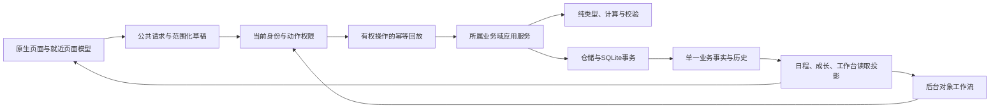

# 当前实现架构

复核：2026-10-30，优化起始基线 `41f615d7`（原产品 `91ae7bc0`），CQ集成代码见当前任务与交付记录。本页描述实现，不改变 [产品需求](product-requirements/README.md)。旧实体设计和2026-07交接事实保存在[历史架构](../archive/architecture-before-2026-10-21.md)。

- `packages/domain`：类型、业务计算与校验；`apps/api`：Fastify 5、路由/应用服务/仓储；`apps/backoffice`：Umi/React 管理界面；`apps/miniprogram-cq-talent`：原生 TypeScript/WXML/WXSS 小程序。
- API 使用 Node 24 的 `node:sqlite`，当前仓库有 46 个 SQL 迁移文件；内存重放生成105张表，另有迁移记录和环境归属2张运行时元数据表。运行入口/迁移和持久化实现分别见 `apps/api/src/index.ts`、`src/migrate.ts`、`src/persistence/`。数量是源码事实，不是线上库盘点。
- 单实例 SQLite、短事务、版本冲突与留痕是当前工程边界。没有本轮实测的 DAU/吞吐 SLA；不以历史“500日活”说法作容量保证，也不启动数据库重构。
- 小程序经 app-client BFF 使用真实微信手机号连接器与 Bearer 会话；服务器对 active role、guardian、教练队伍和具体动作授权。后台使用自己的认证与授权；客户端隐藏按钮不构成权限控制。
- 训练事实在 `training-records`，系统按课程结束时刻对账；人工修正优先、取消课不计次、请假/撤回追加历史。课包账本独立，训练记录不会自动扣账。
- 测评工作流区分原始值、分值、等级，草稿、确认与修订；家长只读取已确认版本。教练队伍评价是独立沟通记录，不是测评发布数量或能力分。
- 后台已有资料、导入、评分映射、模型、标准、任务、BI、服务资源路由；“有路由/表单”不代表全部客户数据和跨端流程验收。标准的家长适用匹配、C34服务跟进等差距见[矩阵](post-optimization-audit-2026-10-21/product-gap-matrix.md)。

## 领域、基础设施与发布单元

已批准采用模块化单体，九个业务域及全部表的主要所有者见[产品域与数据所有权](product-domain-map.md)和[机器可读清单](product-domain-map.json)。日程、测评、队伍评价、比赛各持有自己的事实；成长/首页/工作台/BI是读取投影。基础设施承接环境、会话、事务、接入、审计和制品机制，不接管计次、发布或业务权限规则。

当前服务端镜像包含 API、后台静态资源及进程内计次任务；家长/教练为同一个原生小程序发布单元。保持两个正式发布单元，迁移使用同镜像的一次性命令，环境数据库和会话各自隔离。环境镜像解耦与版本清单已用于本轮develop交付，实际源码/镜像和未验边界见[2026-10-30交付报告](cq-optimization-delivery-2026-10-30.md)；trial/release未随之更新。

细节以 `apps/api/src/routes/`、应用服务、数据库迁移和[包级开发规范](../../.trellis/spec/api/backend/index.md)共同核对。版本及本轮交付状态只从[交付入口](development-delivery-channel.md)读取；部署要求中的历史版本和容量目标不替代当前证据。

## 本轮实现的数据与交付路径

领域所有权见[完整表清单](product-domain-map.md)。基础设施提供认证、传输、持久化、事务、任务运行与观测机制；发布、更正、计次和范围规则由对应业务维护。单实例SQLite和内部计次任务保留，未拆成微服务。

服务端镜像同时包含API、后台资源与内部任务；微信小程序是独立制品。环境按不可变镜像ID分别启动；版本信息按显式用户操作读取，客户端源码/平台版本与服务端构建身份分别显示。迁移0046只增加课堂表现事件revision，原分数与历史不搬表、不重算。课堂冲突先保留输入再核对，测评确认与友谊赛完成修订仍遵循各自合同。
